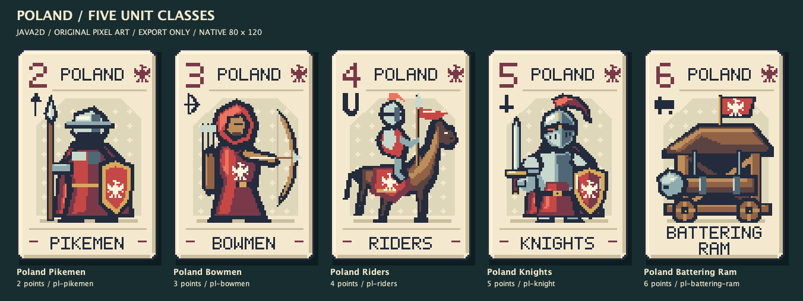
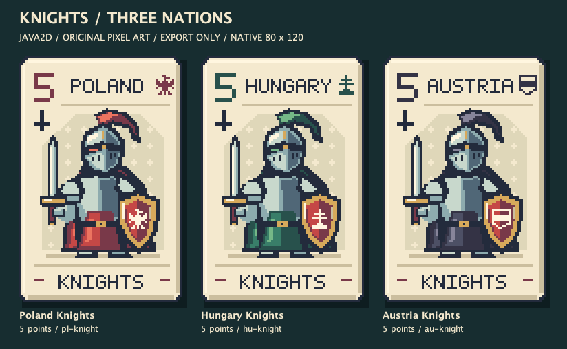

# Unit pixel pack v1 — giao cho Claude sau

> **Đã có bản thay thế:** người dùng chọn Axemen 4 điểm thay Battering Ram ngày 2026-10-21.
> Dùng [unit-pixel-v2-axemen](../unit-pixel-v2-axemen/README.md) cho lần tích hợp mới.
> Nội dung dưới đây ghi lại pack v1 trước thay đổi đó.

**Ngày tạo: 2026-10-21.** Bảy mặt Unit vẽ bằng code Java2D, không dùng ImageGen.
Batch này chỉ xuất file trong folder riêng; không sửa renderer runtime, catalog hoặc resource
của game. Ba Knights là bản xuất lại từ thiết kế mẫu đã có; bốn class Poland còn lại là hình mới.
Ba Knights trước đó đã được nối vào game ở task trước, không phải do batch này.

## Xem trước





`preview-all.png` gộp đủ bảy card. Các ảnh này là contact sheet của exporter Java2D,
không phải screenshot của match đang chạy.

## File để dùng

| Thư mục / file | Nội dung |
| --- | --- |
| `native/` | 7 PNG RGBA **80×120**, lưới pixel gốc, không shadow |
| `png-4x/` | 7 PNG RGBA **320×480**, nearest-neighbour 4×, không shadow |
| `source/UnitCardRenderer.java` | Toàn bộ hình vẽ, palette, crest và font bitmap; Java 17, không thư viện ngoài |
| `source/ExportUnitCards.java` | Đọc catalog thật, render, kiểm tra và xuất bộ ảnh |
| `manifest.json` | ID, metadata, đường dẫn tương đối, SHA-256 ảnh và catalog lúc export |
| `VERIFICATION.md` | Kết quả kiểm grid, palette, alpha, scale và deterministic render |
| `HANDOFF.md` | Hướng dẫn Claude nối vào game khi người dùng yêu cầu |

Tất cả card giữ tên/class/nation/điểm từ catalog `cards-neutral-3`:

| ID | Nation | Class | Điểm |
| --- | --- | --- | ---: |
| `pl-pikemen` | Poland | Pikemen | 2 |
| `pl-bowmen` | Poland | Bowmen | 3 |
| `pl-riders` | Poland | Riders | 4 |
| `pl-knight` | Poland | Knights | 5 |
| `pl-battering-ram` | Poland | Battering Ram | 6 |
| `hu-knight` | Hungary | Knights | 5 |
| `au-knight` | Austria | Knights | 5 |

## Tái xuất

Chạy từ root repo; output là chính folder pack, các PNG/manifest/verification được tạo lại.
Không cần Maven, JavaFX, tài khoản, database hoặc network. `.class` đặt trong `/tmp`.

```sh
javac --release 17 -d /tmp/deckduel-unit-pack-v1 art/cards/exports/unit-pixel-v1/source/UnitCardRenderer.java art/cards/exports/unit-pixel-v1/source/ExportUnitCards.java
java -Djava.awt.headless=true -cp /tmp/deckduel-unit-pack-v1 ExportUnitCards art/cards/exports/unit-pixel-v1 src/main/resources/cards/catalog.txt
```

Nếu copy pack khỏi repo, truyền đường dẫn catalog có các ID tương ứng vào đối số thứ hai.
Không tự sửa catalog để phù hợp pack; nếu metadata đổi, kiểm lại hình và text trước khi tích hợp.
Native/4× PNG có thể tái lập pixel; font hệ thống trong caption ngoài card có thể khác giữa máy.

Không có Spell trong pack này. Dùng `CARD_RENDERING_GUIDE.md` ở root repo để đọc quy cách
renderer và các mẫu Spell của task trước.
