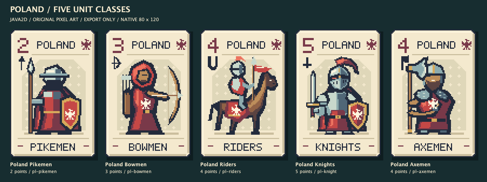

# Unit pixel pack v2 — Axemen 4 điểm

**2026-10-21: người dùng chọn Axemen (lính rìu), 4 điểm, thay Battering Ram.**
Pack này thay thế `unit-pixel-v1` cho lần tích hợp sau. Bản v1 được giữ để đối chiếu.
Theo yêu cầu để Claude thêm vào game sau, batch này chỉ tạo bộ xuất riêng; không sửa
`src/main/resources/cards/catalog.txt`, renderer runtime hoặc luật đang chạy.



## Bảy ảnh trong pack

| ID | Class | Nation | Điểm |
| --- | --- | --- | ---: |
| `pl-pikemen` | Pikemen | Poland | 2 |
| `pl-bowmen` | Bowmen | Poland | 3 |
| `pl-riders` | Riders | Poland | 4 |
| `pl-knight` | Knights | Poland | 5 |
| `pl-axemen` | Axemen | Poland | 4 |
| `hu-knight` | Knights | Hungary | 5 |
| `au-knight` | Knights | Austria | 5 |

Axemen vẽ mới bằng Java2D trên lưới 80×120; sáu thiết kế còn lại giữ từ v1.
Riders và Axemen cùng điểm nhưng khác class. Không thêm ability cho Axemen.

| File / folder | Công dụng |
| --- | --- |
| `native/` | 7 PNG RGBA 80×120, không shadow |
| `png-4x/` | 7 PNG RGBA 320×480, nearest-neighbour 4× |
| `preview-poland.png` | Năm class Poland |
| `preview-nations.png` | Knights của ba quốc gia |
| `preview-all.png` | Cả bảy card |
| `source/` | Renderer/exporter Java 17 độc lập, không cần Maven/JavaFX |
| `manifest.json` | Metadata và SHA-256 ảnh/catalog snapshot |
| `catalog-axemen-preview.txt` | Snapshot thiết kế đích cho 7 quốc gia; **chưa phải catalog live** |
| `HANDOFF.md` | Hướng dẫn Claude chuyển catalog/game khi được yêu cầu |
| `VERIFICATION.md` | Kiểm palette, alpha, scaling và deterministic render |

`catalog-axemen-preview.txt` đổi đủ bảy Battering Ram 6 thành Axemen 4, giữ 35 Units,
10 Spells và 5 class. Nhãn `cards-neutral-3-axemen-preview` chỉ đánh dấu bản export;
Claude phải chọn version production phù hợp khi tích hợp, không ghi đè lịch sử match.
Ảnh hiện chỉ có **Poland Axemen**; sáu nation Axemen còn lại chưa được vẽ.

## Tái xuất từ root repo

```sh
javac --release 17 -d /tmp/deckduel-unit-pack-v2 art/cards/exports/unit-pixel-v2-axemen/source/UnitCardRenderer.java art/cards/exports/unit-pixel-v2-axemen/source/ExportUnitCards.java
java -Djava.awt.headless=true -cp /tmp/deckduel-unit-pack-v2 ExportUnitCards art/cards/exports/unit-pixel-v2-axemen art/cards/exports/unit-pixel-v2-axemen/catalog-axemen-preview.txt
```

Dùng snapshot của pack làm input: catalog live vẫn còn Battering Ram nên chưa có `pl-axemen`.
PNG là mặt card hoàn chỉnh, đã có điểm/tên/nation/class. Bộ export không load ảnh AI,
không dùng tài khoản, không tạo database và không được game tự động load.
